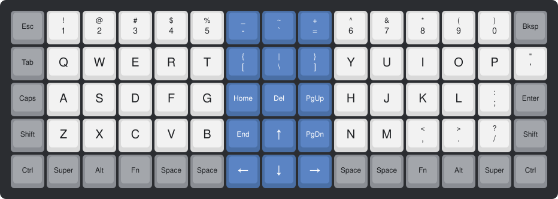

# LE75HE

LE75HE is a 75-key Hall-effect keyboard PCB in the XD75 form factor (15 × 5 grid, all 1U), running [libhmk](https://github.com/peppapighs/libhmk) firmware with 8 kHz polling.

## Status

- Work in progress. PCB and plate are routed but **not yet fabricated or verified**. Do not order yet.
- Firmware definition is generated from the PCB netlist and passes the libhmk schema check; it is untested on hardware.

## Layout



Alphanumerics and modifiers sit in the left (columns 1–6) and right (columns 10–15) blocks. The three centre columns hold `-` `` ` `` `=`, `[` `\` `]`, Home/Del/PgUp, End/↑/PgDn and ←/↓/→. Source: [`keyboard-layout.json`](keyboard-layout.json) ([keyboard-layout-editor.com](http://www.keyboard-layout-editor.com)).

### Fn layer (default)

| Key        | Fn            | Key           | Fn                 |
| ---------- | ------------- | ------------- | ------------------ |
| 1–5, 6–0   | F1–F5, F6–F10 | Home / Del / PgUp | Ins / – / Vol+ |
| `-` / `=`  | F11 / F12     | ↑ / PgDn      | Mute / Vol−        |
| Backspace  | Delete        | ← / ↓ / →     | Prev / Play / Next |
| `[` `\` `]`| PrtSc / ScrLk / Pause | U / I / O / P | Profile 0–3 |
| `'`        | Bootloader    | Enter         | Profile swap       |

Layers 2–3 are empty. Everything is remappable in [hmkconf](https://hmk.prasertsuk.com) without reflashing.

## Hardware

| Function        | Part                         | Designator |
| --------------- | ---------------------------- | ---------- |
| MCU             | AT32F405RCT7 (LQFP-64)       | U4         |
| Crystal         | 12 MHz, X322512MSB4SI, 2 × 30 pF | Y1, C152, C153 |
| Hall sensors    | 75 × DRV5055A3 (SOT-23-3), see below | HE1–HE75 |
| Analog muxes    | 10 × SN74LV4051A (TSSOP-16)  | AM1–AM10   |
| LDO, digital    | TLV75733PDYDR, 3.3 V         | U6 (+3.3V) |
| LDO, analog     | TLV75733PDYDR, 3.3 V         | U5 (+3.3VA, sensors + muxes) |
| USB-C           | HRO TYPE-C-31-M-12, CC 2 × 5.1 kΩ | J1, R1, R2 |
| Alt. USB input  | JST SH 1.0 mm 4-pin (VBUS, D−, D+, GND) | J2 |
| ESD             | USBLC6-2SC6                  | U1         |
| Fuse            | BSMD0805-050-24V (500 mA hold) | F1       |
| Reset / Boot    | TS-1187A tactile switches    | SW1 (NRST), SW2 (BOOT0) |
| BOOT0 pull-down | 12 kΩ                        | R4         |
| USB HS bias     | 12 kΩ to GND on OTGHS1_R     | R3         |

- PCB: approx. 285 × 94 mm, switches on 19.05 mm pitch.
- Mounting: 10 × M2 holes (2.2 mm drill).
- Plate: [`plate.dxf`](plate.dxf), KiCad source in [`plate/`](plate/).
- J1 and J2 share the same USB lines; populate only one.

### Case compatibility

- **Gasket mount**: recommended. Should work in 60% gasket-mount cases, as the plate and PCB are held by the gaskets, not the screw holes.
- **Tray mount**: unlikely to work with most 60% cases. The mounting hole layout does not match standard 60% (GH60) tray positions.
- Verify USB-C position and plate fit against the specific case before ordering.

### Pin assignment (U4)

| Signal         | MCU pin     | Connected to |
| -------------- | ----------- | ------------ |
| MUX_SELECT_0   | PC1 (9)     | AM1–AM10 A (11) |
| MUX_SELECT_1   | PC2 (10)    | AM1–AM10 B (10) |
| MUX_SELECT_2   | PC3 (11)    | AM1–AM10 C (9)  |
| MUX_OUT_1      | PA3 (17)    | AM1 X  — HE1–HE8 |
| MUX_OUT_2      | PA4 (20)    | AM2 X  — HE9–HE15 |
| MUX_OUT_3      | PA5 (21)    | AM3 X  — HE16–HE22 |
| MUX_OUT_4      | PA6 (22)    | AM4 X  — HE23–HE30 |
| MUX_OUT_5      | PA7 (23)    | AM5 X  — HE31–HE38 |
| MUX_OUT_6      | PC4 (24)    | AM6 X  — HE39–HE45 |
| MUX_OUT_7      | PC5 (25)    | AM7 X  — HE46–HE49, HE61–HE64 |
| MUX_OUT_8      | PB0 (26)    | AM8 X  — HE50–HE53, HE65–HE68 |
| MUX_OUT_9      | PB1 (27)    | AM9 X  — HE54–HE57, HE69–HE72 |
| MUX_OUT_10     | PA2 (16)    | AM10 X — HE58–HE60, HE73–HE75 |
| HEXT_IN / OUT  | PF0 (5) / PF1 (6) | Y1 |
| USB D− / D+    | OTGHS1_D− (34) / D+ (35) | U1 → J1 / J2 |
| OTGHS1_R       | 33          | R3 |
| BOOT0          | PF11 (60)   | SW2, R4 |
| NRST           | 7           | SW1 |

Sensor `HEn` sits under key `n`, counted row-major from the top-left; firmware key index is `n − 1`. The exact channel mapping is in [`firmware/le75he/keyboard.json`](firmware/le75he/keyboard.json). Unused mux channels (AM2 X3, AM3 X6, AM6 X3, AM10 X3, AM10 X5) are tied to GND.

### Hall-effect sensor

**Recommended: DRV5055A3** (Texas Instruments, SOT-23 `DBZ` package).

- Drop-in: SOT-23 pinout is 1 VCC, 2 OUT, 3 GND, matching the footprint. The schematic/PCB still carry the value `MT9102ET`; select DRV5055A3 instead at assembly.
- Lower supply current: 2 mA typ / 4 mA max at 3.3 V, i.e. ~150 mA typ for 75 sensors on the analog LDO (U5).
- Sensitivity ≈ 15 mV/mT at 3.3 V (±85 mT range), close to MT9102ET (≈ 16 mV/mT), so the firmware's default calibration applies to both.
- Decoupling: the existing 100 nF per sensor on VCC meets TI's 10 nF minimum. Check the 4.7 nF capacitor on each OUT against the datasheet's output load limit.

Other linear ratiometric 3.3 V Hall sensors in SOT-23-3 with the same pinout (VCC, OUT, GND) can be substituted. Check the pinout first; calibration may need adjusting in hmkconf. Known options:

- DRV5055A3 (recommended)
- MT9102ET (schematic value)
- GH39FKSW
- SS39ET
- OH49E-S (discontinued)

## Firmware

The libhmk keyboard definition is in [`firmware/le75he/`](firmware/le75he/). Summary:

- Driver `at32f405xx`, HSE 12 MHz, USB high-speed port.
- 75 keys, 4 profiles, 4 layers, 32 advanced keys.
- Mux select `C1, C2, C3`; ADC inputs `A3, A4, A5, A6, A7, C4, C5, B0, B1, A2`.
- Calibration defaults (DRV5055A3 / MT9102ET): rest 2400, bottom-out threshold 650, ADC not inverted. Auto-calibration refines these per key at runtime.

Build:

```bash
git clone https://github.com/peppapighs/libhmk.git
```

```bash
cp -r firmware/le75he libhmk/keyboards/
```

```bash
cd libhmk && python setup.py -k le75he && pio run
```

Flash `.pio/build/le75he/firmware.bin` over DFU: hold **BOOT** (SW2) while plugging in, then use [WebUSB DFU](https://devanlai.github.io/webdfu/dfu-util/) or `pio run --target upload`. On Windows the DFU driver may need to be installed with Zadig.

## Repository

| Path                   | Content |
| ---------------------- | ------- |
| `HE75/`                | KiCad PCB project (schematic, layout, footprint/symbol libraries) |
| `plate/`, `plate.dxf`  | Switch plate |
| `firmware/le75he/`     | libhmk keyboard definition |
| `keyboard-layout.json` | Layout source (KLE) |
| `doc/layout.svg`       | Layout image |

## Credits

Derived from [peppapighs/HE60](https://github.com/peppapighs/HE60). Licensed under GPL-3.0, see [LICENSE](LICENSE).
